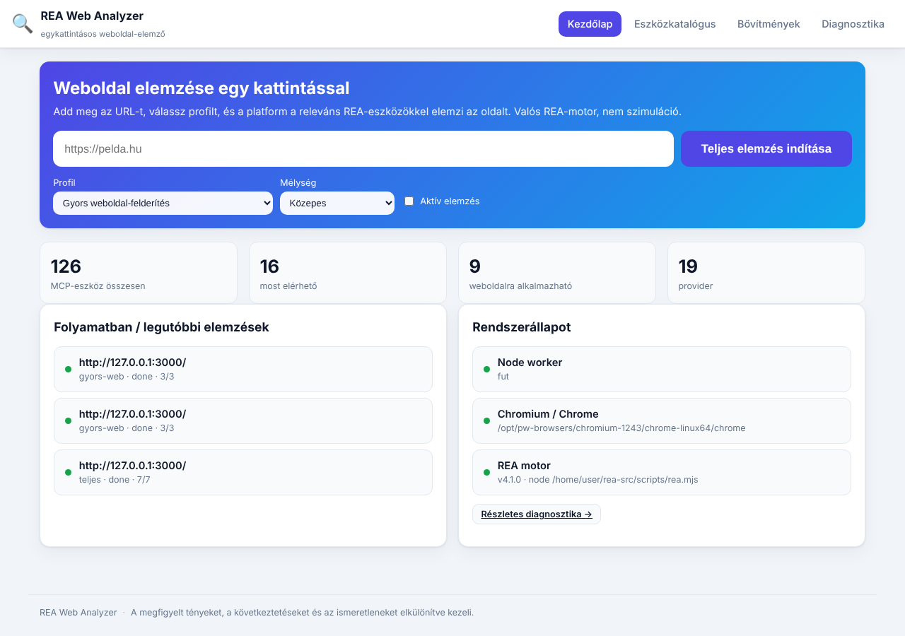

# REA Web Analyzer

Egykattintásos, magyar nyelvű, mobilbarát **weboldal-elemző platform**, amely a
valódi **REA (Reverse Engineer Anything)** motorra épül, és Windows alatt
**XAMPP (Apache + PHP)** kiszolgálóval fut. Nem klónozó és nem mockup: a
beírt URL-t egy kattintással, a ténylegesen releváns REA-eszközökkel elemzi,
és minden eredményt valós `evidence` azonosítóval dokumentál.



## Mit tud

- **Egykattintásos elemzés:** URL → profil → „Teljes elemzés indítása". A rendszer
  elindítja a Chromiumot távoli hibakereséssel, ránavigál az oldalra, és a
  passzív REA web-eszközöket futtatja ellene (DOM, scriptek, bundle, route-/
  endpoint-jelöltek, hálózat, WebMCP, képernyőkép, script-export).
- **Teljes eszközkatalógus:** mind a **126 REA MCP-eszköz** megjelenik valós
  állapottal, kategóriával, célformátummal, providerrel és magyar leírással.
- **Diagnosztika:** mi érhető el ténylegesen, mi hiányzik, és miért.
- **Profilok:** gyors / részletes / JavaScript / frontend-architektúra /
  böngésző-megfigyelés / hálózat / teljes / egyéni.
- **GitHub-bővítmények:** manifest-alapú, commit-rögzítéssel, alapból letiltva.
- **Biztonság:** SSRF-védelem, CSRF, parancsinjektálás-mentes futtatás
  (arg-tömb, soha nem shell), idő-/erőforráskorlátok.
- **Export:** HTML / JSON / CSV / Markdown.

## Architektúra

```
Böngésző (SPA, magyar)  ──HTTP──►  PHP API (XAMPP/Apache)
                                      │  fájlalapú job-sor (storage/jobs)
                                      ▼
                             Node worker  ──►  valódi `rea` CLI  ──►  Chromium (CDP)
                                      │
                               bizonyíték + jelentés
```

- A **PHP sosem indít folyamatot** – csak JSON job-okat ír, és az állapotot olvassa.
- A **Node worker** indítja a böngészőt és a `rea` CLI-t, szigorú validációval.

## Gyors indítás (fejlesztői, XAMPP nélkül)

```bash
cp config/config.sample.json config/config.json   # szerkeszd: rea_home, rea_cmd, chrome_path
node bin/generate-tool-registry.mjs --rea-home /út/a/rea-src
node worker/worker.mjs &
php -S 127.0.0.1:8080 deploy/router.php
# böngésző: http://127.0.0.1:8080/
```

XAMPP/Windows telepítés: lásd **[docs/TELEPITES.md](docs/TELEPITES.md)**.
Állapot és korlátok: lásd **[docs/ATADAS.md](docs/ATADAS.md)**.

## Könyvtárszerkezet

```
rea-analyzer/
├─ index.html, assets/        # frontend (HTML/CSS/vanilla JS SPA)
├─ api/                       # PHP backend (front controller + lib/)
├─ worker/                    # Node worker + lib (a rea CLI-t hajtja)
├─ bin/                       # eszközregiszter-generátor + chromium-feloldó
├─ config/                    # config.sample.json → config.json
├─ storage/                   # fájlalapú job-/plugin-tár (nem webre kitett)
├─ plugins/                   # telepített bővítmények
├─ deploy/xampp/              # Apache conf + start-worker.bat
├─ tests/                     # PHP + API + UI tesztek
├─ docs/                      # TELEPITES.md, ATADAS.md
└─ tool-registry.json         # generált eszközleltár
```

## Tesztek

```bash
bash tests/run-all.sh http://127.0.0.1:8080
```
